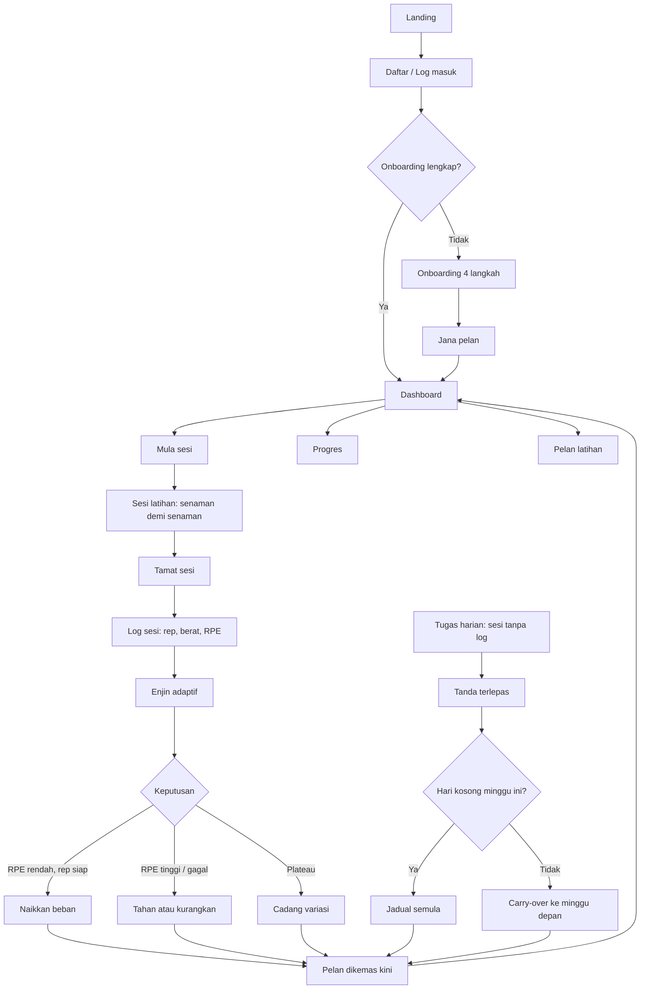
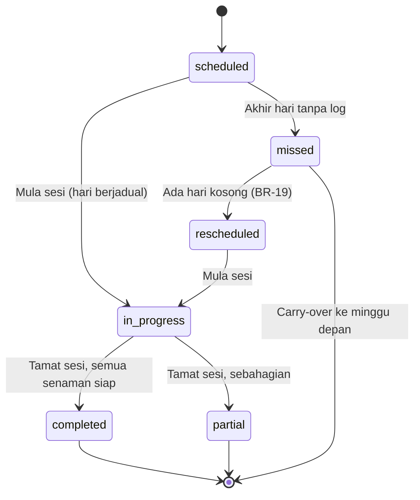
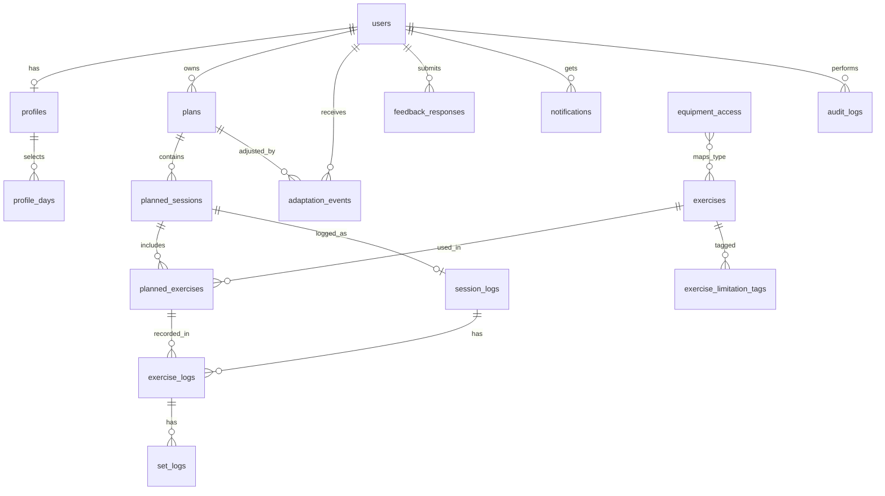

# PROMPT_SYSTEM.md: FitAdapt

> Dokumen spesifikasi binaan (build spec) untuk **FitAdapt**, sistem pelan latihan adaptif untuk pelajar dan pemula gim.
> Diterbitkan daripada 13 wireframe halaman MVP. UI dalam **Bahasa Melayu**.
> Baca **Bahagian 0** dahulu, kemudian bina mengikut **Bahagian 9 (Susunan pembinaan)**.

---

## 0. Arahan kepada AI pembina

Anda pembangun web senior. Bina web app **FitAdapt** mengikut dokumen ini.

**Peraturan wajib**
1. Stack: **Node.js + Express + MySQL 8**, frontend **HTML/CSS/JS** (tanpa framework berat), graf guna **Chart.js**.
2. UI Bahasa Melayu sepenuhnya (label, mesej ralat, mesej kejayaan). Kod, nama jadual dan nama pembolehubah dalam Bahasa Inggeris.
3. **Mobile-first** dan responsif. Halaman Pengguna direka untuk telefon (digunakan di gim). Halaman Admin direka untuk desktop tetapi tidak rosak pada tablet.
4. Semua peraturan dalam **Bahagian 4 (Business rules)** dikuatkuasakan di **backend**. Pengesahan frontend hanyalah bantuan UX.
5. Keselamatan: kata laluan di-hash dengan **bcrypt**, semua query **parameterized**, RBAC melalui middleware (`requireAuth`, `requireRole`), had kadar (rate limit) pada log masuk, sesi/JWT dalam cookie `httpOnly`.
6. Jangan hardcode data. Sediakan **seed** (Bahagian 6.6) supaya sistem boleh diuji serta-merta.
7. Setiap fungsi enjin adaptif mesti ditulis sebagai fungsi tulen (pure function) di `services/adaptiveEngine.js` supaya mudah diuji.
8. Bina **satu modul pada satu masa** mengikut Bahagian 9. Selepas setiap modul, berhenti dan tunjukkan cara menguji.
9. Jika ada percanggahan antara wireframe dan dokumen ini, ikut **Bahagian 2.3 (Keputusan reka bentuk)**.

---

## 1. Ringkasan sistem

**Masalah:** Pelajar pemula tidak mampu mengambil jurulatih peribadi, menggunakan pelan rawak dari internet, lupa set dan rep, log tidak konsisten, dan pelan tidak relevan apabila sesi terlepas.

**Penyelesaian:** FitAdapt menjana pelan ikut profil, memandu sesi, merekod log (rep, berat, RPE), dan melaraskan pelan secara automatik (progressive overload, pengesanan plateau, auto-reschedule).

**Objektif**
1. Membangunkan modul onboarding dan penjanaan pelan berdasarkan profil pengguna.
2. Membangunkan modul panduan sesi, log latihan dan enjin adaptif berasaskan peraturan.
3. Menguji kebolehgunaan dan keberkesanan bersama pengguna sasaran (pelajar), termasuk dashboard progres.

**Peranan**

| Peranan | MVP | Ringkasan |
|---|---|---|
| Pengguna | Ya | Onboarding, pelan, sesi, log, progres, profil, maklum balas |
| Admin | Ya | Urus senaman, urus akaun, dashboard sistem |
| Jurulatih | Tidak (fasa lanjutan) | Pantau klien, override pelan. Struktur DB disediakan tetapi UI ditangguh |

---

## 2. Analisis wireframe

### 2.1 Reka bentuk visual yang dikenal pasti

| Aspek | Pemerhatian daripada wireframe |
|---|---|
| Halaman awam (landing, daftar) | Latar biru gelap (navy) dengan aksen **oren** untuk CTA utama |
| Aplikasi Pengguna | Latar putih/cerah, warna utama **ungu** untuk butang utama dan elemen aktif, hijau untuk status berjaya/rehat, merah untuk amaran dan "Tamat sesi" |
| Panel Admin | Sidebar gelap dengan item aktif ungu, kad ringkasan putih, jadual dengan lencana status berwarna |
| Tipografi | Sans-serif geometrik (gaya Poppins/Inter), tajuk tebal, teks sokongan kelabu |
| Komponen | Kad bersudut bulat, butang penuh lebar pada telefon, lencana status (pill), bar kemajuan, donut kemajuan, timer bulat, modal untuk borang dan pengesahan |
| Navigasi telefon | Bar bawah 4 tab: **Sesi, Log, Progres, Profil** |
| Navigasi Admin | Sidebar: Dashboard, Urus senaman, Urus akaun, Maklum balas, Admin (profil), Keluar |

Anggarkan token warna berikut dan letakkan dalam CSS variables (`:root`) supaya boleh diselaraskan kemudian:

```css
:root{
  --navy:#0B1F4B;  --orange:#FF8A00;  --purple:#5B3FD9;
  --green:#1F9D55; --red:#D64545;     --amber:#E0A100;
  --bg:#F6F7FB;    --card:#FFFFFF;    --text:#1B1F2A; --muted:#6B7280;
  --radius:14px;
}
```

### 2.2 Analisis setiap halaman

#### Halaman 1: Landing
- **Elemen:** logo dan nama FitAdapt, menu hamburger, tajuk "Pelan latihan yang ikut *rentak kamu*", penerangan, butang **Daftar** (oren) dan **Log masuk** (garis putih), 3 kad kelebihan (Pelan Automatik, Log Mudah, Pelarasan Adaptif), bahagian "3 Langkah Mudah Untuk Mula" (Daftar akaun, Dapatkan pelan, Latih & maju).
- **Data:** statik, tiada API.

#### Halaman 2: Daftar / Log masuk
- **Elemen:** tab **Daftar / Log masuk**, medan Nama Penuh, E-mel, Kata Laluan (toggle papar), Sahkan Kata Laluan, **checkbox persetujuan Terma Penggunaan dan Dasar Privasi**, butang "Daftar Akaun", pautan "Sudah ada akaun? Log masuk di sini", nota privasi.
- **Pemerhatian:** wireframe menambah **persetujuan terma** dan **petunjuk kata laluan** (minimum 8 aksara, gabungan huruf, nombor, simbol digalakkan). Ini tiada dalam spesifikasi asal, jadi ditambah sebagai keperluan (FR-02).

#### Halaman 3: Onboarding
- **Elemen:** stepper 4 langkah (**Maklumat anda, Gaya latihan, Semak, Selesai**). Langkah 1 direka: Matlamat (Bina otot, Kurus, Kecergasan am), Tahap (Pemula, Sederhana), Hari tersedia (Isn-Ahd, "Dipilih: N hari"), Peralatan (Tiada, Dumbbell, Gim penuh), Limitasi (textarea 0/200), butang Kembali dan Seterusnya.
- **Jurang:** langkah 2 (Gaya latihan), 3 (Semak), 4 (Selesai) tiada wireframe. Lihat keputusan **D-01**.

#### Halaman 4: Dashboard utama
- **Elemen:** ucapan "Hai, {nama}!", ikon loceng, kad **Sesi hari ini** (nama sesi, lencana status "Belum dimulakan", senarai senaman dengan gambar kecil dan set x rep, butang **Mula sesi**), kad **Sesi seterusnya** (tarikh, nama sesi), **Ringkasan minggu ini** (sesi siap 3 dari 5, donut 60%, sesi dirancang 5), kad amaran merah **Sesi terlepas**, butang **Lihat pelan**.
- **Pemerhatian:** ada ikon loceng (notifikasi) sedangkan notifikasi ditangguh. Lihat **D-08**.

#### Halaman 5: Pelan latihan
- **Elemen:** tajuk dan ikon kalendar, teks "Pelan ini dilaraskan terakhir pada {tarikh}", 7 baris hari (nama hari dan tarikh) dengan kad sesi (nama sesi, senaman dengan set x rep dan beban kg), kad **Hari rehat** (hijau), butang **Buka sesi** pada hari semasa, nota "Klik pada mana-mana senaman untuk lihat butiran dan alternatif".
- **Pemerhatian:** contoh 5 sesi ialah Push, Bawah Badan (Squat Focus), Tarik (Pull), Atas Badan (Pull), Bawah Badan (Hinge Focus). Ini ialah gabungan (hybrid) dan bukan PPL tulen. Penamaan tidak konsisten (lihat **D-04**).
- **Alternatif senaman:** nota merujuk "alternatif", jadi butiran senaman perlu paparan alternatif (FR-25).

#### Halaman 6: Sesi latihan
- **Elemen:** anak panah kembali, tajuk, penunjuk "Senaman 2 daripada 5" dengan bar kemajuan, kad senaman (nama, gambar demonstrasi), 3 statistik (Set sasaran, Rep sasaran, Beban sasaran), senarai set dengan checkbox, **timer rehat** bulat (contoh 00:59, "Rehat selepas set 1"), butang **Senaman seterusnya** (ungu) dan **Tamat sesi** (merah).

#### Halaman 7: Log sesi
- **Elemen:** nama senaman, lencana status (**Siap**) dan ikon kunci, tarikh dan masa sesi, baris sasaran, **jadual set** (Rep, Berat, **RPE bagi setiap set** sebagai butang bulat), ruang nota (0/200), teks "Log boleh diedit dalam 24 jam", butang **Simpan log**.
- **Pemerhatian penting:** RPE dirakam **bagi setiap set**, log dipaparkan **bagi setiap senaman**. Ini berbeza daripada spesifikasi asal (RPE per sesi). Lihat **D-02**.

#### Halaman 8: Progres
- **Elemen:** dropdown Pilih senaman, toggle **Minggu/Bulan**, graf garisan "Beban (kg) mengikut masa", 4 kad statistik: **Konsistensi 82%**, **Streak Semasa 6 hari**, **Sesi Siap 23**, **Sesi Terlepas 5**.
- **Pemerhatian:** 23 / (23+5) = 82%, jadi konsistensi = sesi siap ÷ (siap + terlepas) bagi sesi yang **sudah tamat tempoh**. Label "(sesi siap + dirancang)" ialah kesilapan, sepatutnya "sesi siap ÷ dirancang". Streak dipaparkan dalam **hari**. Lihat **D-05** dan **D-06**.

#### Halaman 9: Profil & Tetapan
- **Elemen:** senarai profil (Nama, Matlamat, Tahap, Hari tersedia "5 hari / minggu", Peralatan "Dumbbell, Barbell, Bench", Limitasi), mesej hijau "Pelan anda akan dilaraskan mengikut perubahan ini", bahagian Tukar kata laluan (lama, baharu, sahkan), butang **Simpan**, **Tukar kata laluan**, **Log keluar**.
- **Pemerhatian:** Peralatan dipaparkan sebagai **senarai berbilang**, tetapi onboarding hanya **satu pilihan** (Tiada/Dumbbell/Gim penuh). Lihat **D-03**.

#### Halaman 10: Maklum balas
- **Elemen:** 3 soalan skala 1-5 (kemudahan guna, kejelasan pelan, kegunaan pelarasan automatik) dengan label hujung skala, 1 soalan terbuka, butang **Hantar maklum balas**, skrin **Terima kasih** dengan butang "Kembali ke dashboard".
- **Pemerhatian:** sidebar Admin mempunyai item **Maklum balas**, bermakna Admin perlu melihat maklum balas yang dikumpul. Lihat **D-07**.

#### Halaman 11: Dashboard admin
- **Elemen:** sidebar, lencana "Akses: Admin", dropdown Admin, 3 kad ringkasan (Jumlah pengguna, Jumlah senaman aktif, Jumlah sesi dilog minggu ini) dengan **perbandingan peratus berbanding minggu lalu**, bahagian **Pautan pantas** (Urus senaman, Urus akaun).
- **Pemerhatian:** sidebar berjenama "**FitPlan** Admin". Sepatutnya **FitAdapt Admin** (D-09).

#### Halaman 12: Urus senaman
- **Elemen:** jadual (Nama senaman, Otot sasaran, Peralatan, Tahap, Status, Tindakan), carian, penapis otot dan peralatan, butang Reset, **Tambah senaman**, pagination ("Memaparkan 1 hingga 6 daripada 86 senaman"), modal Tambah senaman (Nama, Otot sasaran, Peralatan, Tahap, Status, Batal/Simpan), kotak peraturan tentang nyahaktif.
- **Pemerhatian:**
  - Tahap senaman ada **3 nilai** (Pemula, Sederhana, **Lanjutan**) manakala pengguna hanya ada 2 tahap.
  - Peralatan senaman: **Berat badan, Dumbbell, Barbell, Mesin** (lebih terperinci daripada pilihan pengguna).
  - Senaman "Tidak aktif" hanya ada ikon ubah, tiada cara **mengaktifkan semula** (D-10).
  - Modal tidak mempunyai medan yang diperlukan enjin (kategori split, set/rep lalai, kenaikan beban). Lihat **D-11**.

#### Halaman 13: Urus akaun
- **Elemen:** jadual (Nama, E-mel, Peranan, Status, Tarikh daftar, Tindakan), carian, penapis peranan, Reset, tindakan **Gantung/Aktifkan** dan **Padam**, dialog pengesahan padam, pagination, nota "Admin tidak mempunyai akses untuk melihat log latihan peribadi pengguna".
- **Pemerhatian:** baris akaun Admin **tiada tindakan** (betul, Admin tidak boleh menggantung atau memadam diri sendiri). Status ada Aktif dan Gantung.

### 2.3 Keputusan reka bentuk (mengatasi percanggahan)

| ID | Isu | Keputusan yang digunakan dalam binaan |
|---|---|---|
| **D-01** | Onboarding langkah 2-4 tiada wireframe | **Langkah 2 "Gaya latihan":** masa sesi pilihan (30 / 45 / 60 minit) dan tarikh mula pelan (lalai: hari ini). **Langkah 3 "Semak":** ringkasan semua jawapan dengan butang Ubah. **Langkah 4 "Selesai":** pelan dijana dan pengguna dihalakan ke Dashboard. *(Andaian. Sahkan dengan pensyarah/penyelia jika perlu.)* |
| **D-02** | RPE per set (wireframe) lawan per sesi (spesifikasi) | RPE disimpan **per set** (`set_logs.rpe`). RPE senaman = purata set. RPE sesi = purata semua set. Enjin guna RPE senaman. **BR-12 dikemas kini:** sesi siap apabila pengguna menekan Tamat sesi dan setiap senaman yang dilakukan ada sekurang-kurangnya 1 set dengan RPE. |
| **D-03** | Peralatan pilihan tunggal (onboarding) lawan senarai (profil) | Pengguna memilih **tahap akses peralatan** (Tiada / Dumbbell / Gim penuh). Sistem memetakan kepada jenis peralatan melalui jadual `equipment_access`. Profil memaparkan senarai jenis yang dijana daripada pemetaan itu (hanya baca). |
| **D-04** | Penamaan split tidak konsisten ("Tarik (Pull)" lawan "Atas Badan (Pull)") | Guna satu format: `{Fokus} ({Kategori})` daripada `split_label` yang dijana enjin, contoh "Atas Badan (Push)", "Bawah Badan (Squat)", "Atas Badan (Pull)". |
| **D-05** | Label konsistensi salah | Guna "Sesi siap ÷ sesi sepatutnya" dan lihat D-06 untuk penyebut. |
| **D-06** | Dua penyebut berbeza (Dashboard 3/5 = 60% lawan Progres 23/28 = 82%) | **Dashboard:** siap ÷ dirancang **untuk minggu semasa** (termasuk hari akan datang). **Progres:** siap ÷ (siap + terlepas) untuk sesi yang **sudah tamat tempoh** dalam julat yang dipilih. Kedua-duanya sah, dan label mesti jelas. |
| **D-07** | Item "Maklum balas" dalam sidebar Admin | Tambah halaman **Admin > Maklum balas** (jadual jawapan, purata skor setiap soalan, eksport CSV). Ini menyokong Objektif 3 (ujian kebolehgunaan). |
| **D-08** | Ikon loceng tanpa spesifikasi | Loceng memaparkan **notifikasi dalam app** ringkas (sesi terlepas, pelan dilaraskan). Notifikasi push/e-mel ditangguh. Jadual `notifications` disediakan. |
| **D-09** | Penjenamaan "FitPlan Admin" | Gantikan dengan **FitAdapt Admin** dan e-mel seed `admin@fitadapt.com`. |
| **D-10** | Senaman tidak aktif tiada cara aktifkan semula | Tambah butang **Aktifkan** pada baris tidak aktif. |
| **D-11** | Modal senaman kekurangan medan enjin | Tambah bahagian **"Tetapan latihan"** dalam modal: kategori split, set lalai, julat rep lalai, kenaikan beban (kg), beban permulaan pemula/sederhana, tag limitasi, URL gambar, arahan. |
| **D-12** | Streak dalam "hari" lawan BR-24 (sesi berturut) | Streak = bilangan **sesi dirancang berturut-turut yang siap** tanpa terlepas, dipaparkan sebagai "**N sesi**" (bukan hari, kerana hari rehat tidak sepatutnya memutuskan streak). |
| **D-13** | Log dipaparkan per senaman, status sesi per sesi | Halaman Log sesi mempunyai **senarai senaman** dalam sesi (tab/dropdown). Setiap senaman ada status **Siap/Separa/Terlepas**. Status sesi diterbitkan daripada senaman. |
| **D-14** | Bar navigasi bawah tiada Dashboard, Pelan, Maklum balas | Tab bawah: **Sesi** (Dashboard), **Log**, **Progres**, **Profil**. **Pelan** dicapai dari Dashboard ("Lihat pelan"). **Maklum balas** dicapai dari Profil. |
| **D-15** | Sesi 5 hari dalam wireframe tidak PPL tulen | Templat 5 hari mengikut wireframe: Push, Bawah (Squat), Pull, Atas (Pull/Push campuran), Bawah (Hinge). Templat lain dalam Bahagian 7.2. |
| **D-16** | Sesi terlepas apabila semua hari tersedia sudah ada sesi | Lihat peraturan **BR-19** yang dikemas kini dalam Bahagian 4. |

---

## 3. Keperluan sistem

### 3.1 Keperluan fungsian (FR)

**Modul A: Akaun dan akses**

| ID | Keperluan | Keutamaan |
|---|---|---|
| FR-01 | Pengguna boleh mendaftar dengan nama penuh, e-mel, kata laluan dan pengesahan kata laluan | Wajib |
| FR-02 | Pendaftaran menuntut persetujuan Terma Penggunaan dan Dasar Privasi (tarikh persetujuan disimpan). Kata laluan minimum 8 aksara | Wajib |
| FR-03 | Pengguna boleh log masuk dan log keluar. Akaun bergantung dihalang dan mesej jelas dipaparkan | Wajib |
| FR-04 | Selepas log masuk, pengguna dihalakan ikut peranan dan status onboarding (belum lengkap ke Onboarding, sudah lengkap ke Dashboard, Admin ke Dashboard admin) | Wajib |
| FR-05 | Pengguna boleh menukar kata laluan (lama, baharu, sahkan) | Wajib |

**Modul B: Onboarding dan penjanaan pelan**

| ID | Keperluan | Keutamaan |
|---|---|---|
| FR-06 | Onboarding berlangkah (4 langkah) dengan penunjuk langkah dan navigasi Kembali/Seterusnya | Wajib |
| FR-07 | Rekod matlamat, tahap, hari tersedia (2-6), tahap akses peralatan dan limitasi (maks 200 aksara) | Wajib |
| FR-08 | Butang seterusnya/jana dinyahaktif sehingga medan wajib sah, dan pemilihan hari memaparkan kiraan "Dipilih: N hari" | Wajib |
| FR-09 | Sistem menjana pelan mingguan secara automatik daripada profil dan pangkalan senaman (Bahagian 7.2) | Wajib |
| FR-10 | Pengguna boleh mengemas kini profil, dan pelan dijana semula atau dilaraskan mengikut perubahan (Bahagian 7.7) | Wajib |

**Modul C: Pelan, sesi dan log**

| ID | Keperluan | Keutamaan |
|---|---|---|
| FR-11 | Halaman Pelan memaparkan 7 hari, sesi, senaman (set x rep, beban), hari rehat dan tarikh pelan dilaraskan terakhir | Wajib |
| FR-12 | Dashboard memaparkan sesi hari ini (atau mesej rehat), sesi seterusnya, ringkasan minggu (siap vs dirancang, peratus) dan amaran sesi terlepas | Wajib |
| FR-13 | Halaman Sesi memandu pengguna satu senaman pada satu masa dengan sasaran, checkbox set, timer rehat automatik selepas set ditanda dan bar kemajuan | Wajib |
| FR-14 | Pengguna boleh menamatkan sesi, dan sistem menghalakan ke Log sesi | Wajib |
| FR-15 | Log sesi merekod rep, berat dan RPE (1-10) bagi setiap set, status senaman dan nota (maks 200 aksara) | Wajib |
| FR-16 | Log boleh diedit dalam masa 24 jam selepas sesi tamat, kemudian dikunci dengan penunjuk kunci | Wajib |
| FR-17 | Sesi yang tiada log sehingga hari itu berakhir ditanda **terlepas** secara automatik | Wajib |

**Modul D: Enjin adaptif**

| ID | Keperluan | Keutamaan |
|---|---|---|
| FR-18 | Progressive overload: naikkan beban apabila syarat BR-16 dipenuhi | Wajib |
| FR-19 | Tahan atau kurangkan beban apabila syarat BR-17 dipenuhi | Wajib |
| FR-20 | Kesan plateau dan cadangkan variasi atau minggu ringan (BR-18) | Wajib |
| FR-21 | Auto-reschedule sesi terlepas dan kurangkan volume selepas terlepas berturut-turut (BR-19, BR-20) | Wajib |
| FR-22 | Setiap pelarasan direkod dalam `adaptation_events` dengan sebab dan kod peraturan | Wajib |
| FR-23 | Pengguna melihat sebab pelarasan (contoh: "Beban dinaikkan kerana RPE ≤ 7 dua sesi berturut-turut") | Sepatutnya |
| FR-24 | Pelarasan hanya menjejaskan sesi akan datang, tidak pernah log lepas (BR-22) | Wajib |
| FR-25 | Klik senaman dalam Pelan memaparkan butiran (gambar, arahan) dan **senaman alternatif** (peralatan dan otot sama, tahap sama atau lebih mudah) | Sepatutnya |

**Modul E: Progres dan maklum balas**

| ID | Keperluan | Keutamaan |
|---|---|---|
| FR-26 | Halaman Progres: dropdown senaman, toggle Minggu/Bulan, graf garisan beban, kad Konsistensi, Streak, Sesi Siap, Sesi Terlepas | Wajib |
| FR-27 | Borang Maklum balas (3 soalan skala 1-5 dan 1 soalan terbuka) dan skrin terima kasih | Wajib |
| FR-28 | Notifikasi dalam app melalui ikon loceng (sesi terlepas, pelan dilaraskan), boleh ditanda dibaca | Sepatutnya |

**Modul F: Admin**

| ID | Keperluan | Keutamaan |
|---|---|---|
| FR-29 | Dashboard admin: jumlah pengguna, senaman aktif, sesi dilog minggu ini dengan perbandingan minggu lalu, dan pautan pantas | Wajib |
| FR-30 | Urus senaman: senarai dengan carian, penapis otot dan peralatan, pagination, tambah, ubah, nyahaktif dan **aktifkan semula** | Wajib |
| FR-31 | Senaman yang digunakan dalam pelan aktif hanya boleh dinyahaktif, tidak boleh dipadam (BR-04) | Wajib |
| FR-32 | Urus akaun: senarai dengan carian, penapis peranan, pagination, gantung, aktifkan, padam (dengan dialog pengesahan) | Wajib |
| FR-33 | Admin tidak boleh menggantung atau memadam akaunnya sendiri, dan tidak boleh melihat log latihan peribadi | Wajib |
| FR-34 | Admin > Maklum balas: jadual jawapan, purata skor dan eksport CSV | Sepatutnya |
| FR-35 | Tindakan Admin (gantung, padam, ubah senaman) direkod dalam `audit_logs` | Sepatutnya |

**Modul G: Jurulatih (fasa lanjutan, tidak dibina dalam MVP)**

| ID | Keperluan |
|---|---|
| FR-36 | Jurulatih melihat senarai klien yang ditugaskan dan konsistensi |
| FR-37 | Jurulatih melihat log dan graf klien |
| FR-38 | Jurulatih override pelan, dan pelan dikunci daripada enjin sehingga dilepaskan (BR-26) |

### 3.2 Keperluan bukan fungsian (NFR)

| ID | Kategori | Keperluan |
|---|---|---|
| NFR-01 | Kebolehgunaan | Semua tindakan utama sesi (tanda set, simpan log) boleh dicapai dengan satu tangan pada telefon. Sasaran sentuh minimum 44 px |
| NFR-02 | Prestasi | Halaman utama dimuatkan dalam kurang 3 saat pada 4G. API biasa bertindak balas dalam kurang 500 ms |
| NFR-03 | Responsif | Layout berfungsi dari lebar 360 px hingga desktop |
| NFR-04 | Keselamatan | bcrypt (cost ≥ 10), parameterized query, RBAC di server, cookie `httpOnly`/`sameSite`, had kadar log masuk, sanitasi input |
| NFR-05 | Privasi | Admin tiada akses kepada log latihan peribadi. Kata laluan tidak pernah dilog atau dihantar semula |
| NFR-06 | Kebolehpercayaan | Enjin adaptif deterministik: input log yang sama menghasilkan pelarasan yang sama. Setiap pelarasan boleh diaudit |
| NFR-07 | Kebolehselenggaraan | Ambang enjin (RPE, bilangan sesi, peratus) disimpan dalam satu fail konfigurasi (`config/engineRules.js`), bukan tersebar dalam kod |
| NFR-08 | Kebolehujian | Enjin adaptif dan penjana pelan mempunyai ujian unit dengan senario dalam Bahagian 8 |
| NFR-09 | Integriti data | Kekangan kunci asing, unik dan semak (CHECK) pada DB. Zon waktu disimpan UTC, dipaparkan Asia/Kuala_Lumpur |
| NFR-10 | Kebolehcapaian | Kontras teks memenuhi WCAG AA, label pada semua input, status tidak bergantung pada warna sahaja |

---

## 4. Peraturan perniagaan (business rules)

Ambang berangka ialah nilai permulaan yang dicadangkan. Ubah dalam `config/engineRules.js`.

### 4.1 Akaun dan akses
| ID | Peraturan |
|---|---|
| BR-01 | E-mel mesti unik. Setiap pengguna mempunyai satu peranan: `user` atau `admin` (`coach` fasa lanjutan) |
| BR-02 | Pengguna hanya boleh melihat dan mengubah profil, pelan dan log sendiri |
| BR-03 | Hanya Admin boleh menambah, mengubah, menyahaktif senaman dan mengurus akaun |
| BR-04 | Senaman yang digunakan dalam pelan aktif dinyahaktif, tidak dipadam. Senaman yang sudah ada log tidak boleh dipadam |
| BR-27 | Admin tidak boleh menggantung atau memadam akaun sendiri. Sekurang-kurangnya satu Admin aktif mesti wujud |
| BR-28 | Akaun bergantung tidak boleh log masuk. Sesi aktifnya ditamatkan |
| BR-29 | Padam akaun memadam data pengguna tersebut secara berantai (profil, pelan, log) selepas pengesahan |

### 4.2 Onboarding dan penjanaan pelan
| ID | Peraturan |
|---|---|
| BR-05 | Pelan tidak boleh dijana sehingga matlamat, tahap, hari tersedia dan peralatan diisi |
| BR-06 | Hari tersedia mestilah 2 hingga 6 hari seminggu |
| BR-07 | Split mengikut hari: **2-3 hari** full body, **4 hari** atas/bawah (upper/lower), **5 hari** hibrid mengikut wireframe (Push, Bawah-Squat, Pull, Atas, Bawah-Hinge), **6 hari** Push/Pull/Legs dua kali. Pemula lalai full body walaupun 4 hari dipilih **hanya jika** pengguna memilih tahap Pemula dan hari ≤ 3 |
| BR-08 | Hanya senaman aktif yang sepadan dengan akses peralatan dan tahap (atau lebih mudah) dipilih |
| BR-09 | Senaman yang bertanda tag limitasi yang sepadan dengan teks limitasi pengguna dikecualikan |
| BR-10 | Pemula bermula dengan volum konservatif (2-3 set, 8-12 rep) |
| BR-11 | Setiap pengguna hanya ada **satu pelan aktif**. Pelan lama diarkib |
| BR-30 | Sesi diletakkan pada hari tersedia pengguna. Hari lain ialah hari rehat |
| BR-31 | Sesi tidak menggunakan senaman yang sama dua hari berturut-turut untuk kumpulan otot yang sama (beri jarak sekurang-kurangnya 48 jam untuk otot utama yang sama) |

### 4.3 Sesi dan log
| ID | Peraturan |
|---|---|
| BR-12 | Sesi siap apabila pengguna menekan **Tamat sesi** dan setiap senaman yang dilakukan ada sekurang-kurangnya satu set dengan RPE (D-02) |
| BR-13 | Rep minimum 1 (bulat), berat 0 atau lebih (langkah 0.5 kg), RPE 1-10 (bulat), nota maks 200 aksara |
| BR-14 | Sesi berjadual tanpa log sehingga akhir hari itu (23:59 waktu Malaysia) ditanda **terlepas** |
| BR-15 | Log boleh diedit dalam 24 jam selepas `ended_at`. Selepas itu dikunci |
| BR-32 | Sesi hanya boleh dimulakan pada hari berjadualnya atau selepas dijadualkan semula. Sesi hari akan datang tidak boleh dimulakan |
| BR-33 | Sesi terlepas tidak boleh dilog secara retroaktif melebihi 24 jam. Selepas itu ia kekal terlepas |
| BR-34 | Status senaman: **Siap** (semua set ditanda), **Separa** (sekurang-kurangnya satu tetapi tidak semua), **Terlepas** (tiada set). Status sesi: Siap jika semua senaman siap, Separa jika sekurang-kurangnya satu senaman siap/separa, Terlepas jika tiada |

### 4.4 Enjin adaptif
| ID | Peraturan |
|---|---|
| BR-16 | **Naikkan beban:** jika semua rep sasaran dicapai dan RPE senaman ≤ 7 dalam **2 sesi berturut-turut** bagi senaman itu, beban sesi seterusnya naik sebanyak `load_increment_kg` |
| BR-17 | **Tahan/kurangkan:** jika RPE senaman ≥ 9, atau rep sasaran gagal dalam **2 sesi berturut-turut**, tahan beban (kes pertama) atau kurangkan 5-10% (kes kedua), dibundarkan kepada 0.5 kg |
| BR-18 | **Plateau:** jika tiada kenaikan beban atau rep merentas **3 sesi berturut-turut** bagi senaman itu (dan bukan kes BR-17), cadangkan variasi (senaman alternatif) atau minggu ringan |
| BR-19 | **Satu sesi terlepas:** alihkan ke **hari tersedia berikutnya yang kosong** dalam minggu yang sama. Jika tiada hari kosong, sesi kekal terlepas dan **fokus otot** sesi itu dibawa (carry-over) ke sesi pertama minggu depan |
| BR-20 | **Dua atau lebih sesi terlepas berturut-turut:** kurangkan volum 20-30% (buang satu set setiap senaman) pada minggu berikutnya |
| BR-21 | Enjin tidak pernah menjadualkan di luar hari tersedia atau menggunakan peralatan yang tidak dipilih |
| BR-22 | Pelarasan hanya untuk sesi akan datang. Log lepas tidak pernah diubah |
| BR-35 | Beban permulaan (tiada sejarah): guna `base_load_beginner_kg` atau `base_load_intermediate_kg` senaman. Jika NULL, papar "Pilih beban ringan" dan gunakan log sesi pertama sebagai asas |
| BR-36 | Maksimum satu pelarasan beban bagi senaman yang sama dalam satu minggu, untuk elak perubahan mendadak |
| BR-37 | Enjin dijalankan selepas setiap log senaman disimpan dan dalam tugas berjadual harian untuk menanda sesi terlepas |

### 4.5 Progres
| ID | Peraturan |
|---|---|
| BR-23 | **Konsistensi (Progres)** = sesi siap ÷ (sesi siap + sesi terlepas) bagi sesi yang tamat tempoh dalam julat dipilih. **Konsistensi (Dashboard)** = sesi siap ÷ sesi dirancang dalam minggu semasa |
| BR-24 | **Streak** = bilangan sesi berjadual berturut-turut yang siap tanpa terlepas. Sesi terlepas menetapkan semula streak kepada 0. Sesi separa tidak menambah dan tidak memutuskan streak |
| BR-38 | Graf beban memaparkan beban kerja tertinggi (top set) setiap sesi bagi senaman dipilih |

### 4.6 Jurulatih (fasa lanjutan)
| ID | Peraturan |
|---|---|
| BR-25 | Jurulatih hanya boleh melihat klien yang ditugaskan kepadanya |
| BR-26 | Override jurulatih mengatasi enjin. Enjin tidak mengubah pelan itu sehingga jurulatih melepaskannya |

---

## 5. Aliran pengguna (workflow)

### 5.1 Aliran keseluruhan



### 5.2 Aliran Pengguna langkah demi langkah

| Langkah | Tindakan pengguna | Respons sistem | Halaman | FR |
|---|---|---|---|---|
| 1 | Buka aplikasi | Papar Landing | Landing | - |
| 2 | Daftar (nama, e-mel, kata laluan, setuju terma) | Sahkan, cipta akaun, halakan ke Onboarding | Daftar | FR-01, 02 |
| 3 | Isi Onboarding langkah 1-3 | Sahkan setiap langkah, papar ringkasan | Onboarding | FR-06, 07, 08 |
| 4 | Sahkan di langkah 4 | Simpan profil, jana pelan, halakan ke Dashboard | Onboarding | FR-09 |
| 5 | Lihat Dashboard | Papar sesi hari ini, sesi seterusnya, ringkasan minggu | Dashboard | FR-12 |
| 6 | Tekan Mula sesi | Cipta `session_logs` (status `in_progress`), papar senaman pertama | Sesi | FR-13 |
| 7 | Tanda set siap | Simpan set, mulakan timer rehat | Sesi | FR-13 |
| 8 | Senaman seterusnya / Tamat sesi | Bawa ke senaman seterusnya atau ke Log sesi | Sesi | FR-14 |
| 9 | Isi rep, berat, RPE, nota, Simpan log | Sahkan, simpan, jalankan enjin | Log sesi | FR-15, 18-22 |
| 10 | Semak Pelan / Progres | Papar pelan dilaraskan dan graf | Pelan / Progres | FR-11, 26 |
| 11 | Kemas kini profil | Simpan, laraskan pelan (7.7) | Profil | FR-10 |
| 12 | Hantar maklum balas | Simpan, papar terima kasih | Maklum balas | FR-27 |

### 5.3 Aliran Admin

| Langkah | Tindakan | Respons |
|---|---|---|
| 1 | Log masuk sebagai Admin | Papar Dashboard admin |
| 2 | Urus senaman: Tambah/Ubah | Sahkan, simpan. Nama mesti unik |
| 3 | Nyahaktif senaman | Tanda `is_active = 0`. Senaman kekal dalam sejarah dan pelan sedia ada |
| 4 | Aktifkan semula senaman | `is_active = 1` |
| 5 | Urus akaun: Gantung/Aktifkan | Kemas kini status, tamatkan sesi pengguna digantung |
| 6 | Padam akaun | Dialog pengesahan, padam berantai, rekod audit |
| 7 | Lihat maklum balas | Papar jadual dan purata skor, eksport CSV |

### 5.4 Mesin keadaan sesi berjadual



---

## 6. Keperluan pangkalan data

**Enjin:** MySQL 8, InnoDB, `utf8mb4`, zon waktu sambungan UTC.
**Konvensyen:** nama jadual `snake_case` jamak, PK `id BIGINT UNSIGNED AUTO_INCREMENT`, cap masa `created_at` dan `updated_at`.

### 6.1 Rajah hubungan entiti (ERD)



### 6.2 Jadual dan medan

#### `users`
| Medan | Jenis | Kekangan |
|---|---|---|
| id | BIGINT UNSIGNED | PK |
| full_name | VARCHAR(100) | NOT NULL |
| email | VARCHAR(150) | NOT NULL, UNIQUE |
| password_hash | VARCHAR(255) | NOT NULL |
| role | ENUM('user','admin','coach') | NOT NULL, DEFAULT 'user' |
| status | ENUM('active','suspended') | NOT NULL, DEFAULT 'active' |
| terms_accepted_at | DATETIME | NOT NULL |
| last_login_at | DATETIME | NULL |
| created_at, updated_at | DATETIME | NOT NULL |

#### `profiles`
| Medan | Jenis | Kekangan |
|---|---|---|
| id | BIGINT UNSIGNED | PK |
| user_id | BIGINT UNSIGNED | NOT NULL, UNIQUE, FK users ON DELETE CASCADE |
| goal | ENUM('build_muscle','lose_weight','general_fitness') | NOT NULL |
| level | ENUM('beginner','intermediate') | NOT NULL |
| equipment_level | ENUM('none','dumbbell','full_gym') | NOT NULL |
| limitation_notes | VARCHAR(200) | NULL |
| session_minutes | TINYINT UNSIGNED | NULL, CHECK IN (30,45,60) |
| plan_start_date | DATE | NULL |
| onboarding_completed | TINYINT(1) | NOT NULL, DEFAULT 0 |
| created_at, updated_at | DATETIME | NOT NULL |

#### `profile_days`
| Medan | Jenis | Kekangan |
|---|---|---|
| profile_id | BIGINT UNSIGNED | FK profiles ON DELETE CASCADE |
| weekday | TINYINT UNSIGNED | CHECK BETWEEN 1 AND 7 (1 = Isnin) |
| | | PK (profile_id, weekday) |

*Bilangan baris bagi setiap profil mesti 2 hingga 6 (disahkan di aplikasi, BR-06).*

#### `equipment_access` (pemetaan D-03)
| Medan | Jenis | Kekangan |
|---|---|---|
| equipment_level | ENUM('none','dumbbell','full_gym') | PK bahagian 1 |
| equipment_type | ENUM('bodyweight','dumbbell','barbell','machine','cable') | PK bahagian 2 |

Data pemetaan: `none` = bodyweight. `dumbbell` = bodyweight, dumbbell. `full_gym` = semua lima jenis.

#### `exercises`
| Medan | Jenis | Kekangan |
|---|---|---|
| id | BIGINT UNSIGNED | PK |
| name | VARCHAR(100) | NOT NULL, UNIQUE |
| muscle_group | ENUM('chest','back','legs','shoulders','arms','core') | NOT NULL |
| split_tag | ENUM('push','pull','legs','core') | NOT NULL |
| movement_focus | ENUM('squat','hinge','none') | NOT NULL, DEFAULT 'none' |
| equipment_type | ENUM('bodyweight','dumbbell','barbell','machine','cable') | NOT NULL |
| level | ENUM('beginner','intermediate','advanced') | NOT NULL |
| default_sets | TINYINT UNSIGNED | NOT NULL, DEFAULT 3 |
| default_rep_min | TINYINT UNSIGNED | NOT NULL |
| default_rep_max | TINYINT UNSIGNED | NOT NULL, CHECK >= rep_min |
| load_increment_kg | DECIMAL(4,2) | NOT NULL, DEFAULT 2.50 |
| base_load_beginner_kg | DECIMAL(5,2) | NULL |
| base_load_intermediate_kg | DECIMAL(5,2) | NULL |
| image_url | VARCHAR(255) | NULL |
| instructions | TEXT | NULL |
| is_active | TINYINT(1) | NOT NULL, DEFAULT 1 |
| created_at, updated_at | DATETIME | NOT NULL |

Indeks: `(is_active, equipment_type, level)`, `(muscle_group)`, FULLTEXT atau `LIKE` pada `name` untuk carian.

#### `exercise_limitation_tags`
| Medan | Jenis | Kekangan |
|---|---|---|
| exercise_id | BIGINT UNSIGNED | FK exercises ON DELETE CASCADE |
| tag | ENUM('knee','back','shoulder','wrist','elbow','neck') | PK (exercise_id, tag) |

Padanan limitasi: kata kunci dalam `profiles.limitation_notes` (contoh "lutut" = knee, "belakang" = back, "bahu" = shoulder, "pergelangan" = wrist, "siku" = elbow, "leher" = neck) dipadankan dengan tag ini untuk BR-09.

#### `plans`
| Medan | Jenis | Kekangan |
|---|---|---|
| id | BIGINT UNSIGNED | PK |
| user_id | BIGINT UNSIGNED | NOT NULL, FK users ON DELETE CASCADE |
| version | INT UNSIGNED | NOT NULL |
| status | ENUM('active','archived') | NOT NULL |
| split_type | ENUM('full_body','upper_lower','hybrid5','ppl6') | NOT NULL |
| generated_by | ENUM('initial','engine','profile_update','coach') | NOT NULL |
| adjusted_at | DATETIME | NOT NULL |
| adjustment_reason | VARCHAR(255) | NULL |
| locked_by_coach | TINYINT(1) | NOT NULL, DEFAULT 0 |
| created_at | DATETIME | NOT NULL |

Kekangan: hanya satu baris `active` bagi setiap `user_id` (guna lajur terjana `active_user_key` = `IF(status='active', user_id, NULL)` dengan UNIQUE).

#### `planned_sessions`
| Medan | Jenis | Kekangan |
|---|---|---|
| id | BIGINT UNSIGNED | PK |
| plan_id | BIGINT UNSIGNED | NOT NULL, FK plans ON DELETE CASCADE |
| scheduled_date | DATE | NOT NULL |
| original_date | DATE | NULL (diisi apabila dijadualkan semula) |
| is_rest | TINYINT(1) | NOT NULL, DEFAULT 0 |
| session_label | VARCHAR(80) | NULL (contoh "Atas Badan (Push)") |
| status | ENUM('scheduled','in_progress','completed','partial','missed','rescheduled') | NOT NULL, DEFAULT 'scheduled' |
| carry_over_focus | ENUM('push','pull','legs','core') | NULL |
| volume_modifier | DECIMAL(3,2) | NOT NULL, DEFAULT 1.00 |
| | | UNIQUE (plan_id, scheduled_date) |

Indeks: `(scheduled_date, status)` untuk tugas harian menanda terlepas.

#### `planned_exercises`
| Medan | Jenis | Kekangan |
|---|---|---|
| id | BIGINT UNSIGNED | PK |
| planned_session_id | BIGINT UNSIGNED | NOT NULL, FK ON DELETE CASCADE |
| exercise_id | BIGINT UNSIGNED | NOT NULL, FK exercises (RESTRICT) |
| order_no | TINYINT UNSIGNED | NOT NULL |
| target_sets | TINYINT UNSIGNED | NOT NULL |
| target_rep_min | TINYINT UNSIGNED | NOT NULL |
| target_rep_max | TINYINT UNSIGNED | NOT NULL |
| target_weight_kg | DECIMAL(5,2) | NULL |
| | | UNIQUE (planned_session_id, order_no) |

#### `session_logs`
| Medan | Jenis | Kekangan |
|---|---|---|
| id | BIGINT UNSIGNED | PK |
| planned_session_id | BIGINT UNSIGNED | NOT NULL, UNIQUE, FK ON DELETE CASCADE |
| user_id | BIGINT UNSIGNED | NOT NULL, FK users ON DELETE CASCADE |
| started_at | DATETIME | NOT NULL |
| ended_at | DATETIME | NULL |
| status | ENUM('in_progress','completed','partial','missed') | NOT NULL |
| session_rpe | DECIMAL(3,1) | NULL (purata semua set) |
| edit_locked_at | DATETIME | NULL (= ended_at + 24 jam) |

#### `exercise_logs`
| Medan | Jenis | Kekangan |
|---|---|---|
| id | BIGINT UNSIGNED | PK |
| session_log_id | BIGINT UNSIGNED | NOT NULL, FK ON DELETE CASCADE |
| planned_exercise_id | BIGINT UNSIGNED | NOT NULL, FK ON DELETE CASCADE |
| exercise_id | BIGINT UNSIGNED | NOT NULL, FK exercises (RESTRICT) |
| status | ENUM('completed','partial','missed') | NOT NULL |
| avg_rpe | DECIMAL(3,1) | NULL |
| top_weight_kg | DECIMAL(5,2) | NULL |
| notes | VARCHAR(200) | NULL |
| | | UNIQUE (session_log_id, planned_exercise_id) |

Indeks: `(exercise_id, session_log_id)` untuk graf beban dan enjin.

#### `set_logs`
| Medan | Jenis | Kekangan |
|---|---|---|
| id | BIGINT UNSIGNED | PK |
| exercise_log_id | BIGINT UNSIGNED | NOT NULL, FK ON DELETE CASCADE |
| set_no | TINYINT UNSIGNED | NOT NULL |
| reps | TINYINT UNSIGNED | NOT NULL, CHECK >= 1 |
| weight_kg | DECIMAL(5,2) | NOT NULL, CHECK >= 0 |
| rpe | TINYINT UNSIGNED | NOT NULL, CHECK BETWEEN 1 AND 10 |
| is_completed | TINYINT(1) | NOT NULL, DEFAULT 1 |
| | | UNIQUE (exercise_log_id, set_no) |

#### `adaptation_events`
| Medan | Jenis | Kekangan |
|---|---|---|
| id | BIGINT UNSIGNED | PK |
| user_id | BIGINT UNSIGNED | NOT NULL, FK ON DELETE CASCADE |
| plan_id | BIGINT UNSIGNED | NOT NULL, FK plans ON DELETE CASCADE |
| exercise_id | BIGINT UNSIGNED | NULL, FK exercises |
| rule_code | VARCHAR(10) | NOT NULL (contoh 'BR-16') |
| action | ENUM('increase_load','hold_load','reduce_load','suggest_variation','reschedule','carry_over','reduce_volume') | NOT NULL |
| old_value | VARCHAR(50) | NULL |
| new_value | VARCHAR(50) | NULL |
| reason_text | VARCHAR(255) | NOT NULL (teks Bahasa Melayu untuk pengguna) |
| created_at | DATETIME | NOT NULL |

Indeks: `(user_id, created_at)`. Digunakan untuk FR-22 dan FR-23, dan menjadi sumber "dilaraskan terakhir".

#### `feedback_responses`
| Medan | Jenis | Kekangan |
|---|---|---|
| id | BIGINT UNSIGNED | PK |
| user_id | BIGINT UNSIGNED | NOT NULL, FK users ON DELETE CASCADE |
| ease_score | TINYINT UNSIGNED | NOT NULL, CHECK BETWEEN 1 AND 5 |
| clarity_score | TINYINT UNSIGNED | NOT NULL, CHECK BETWEEN 1 AND 5 |
| adjustment_score | TINYINT UNSIGNED | NOT NULL, CHECK BETWEEN 1 AND 5 |
| comments | TEXT | NULL |
| created_at | DATETIME | NOT NULL |

#### `notifications`
| Medan | Jenis | Kekangan |
|---|---|---|
| id | BIGINT UNSIGNED | PK |
| user_id | BIGINT UNSIGNED | NOT NULL, FK ON DELETE CASCADE |
| type | ENUM('missed_session','plan_adjusted','info') | NOT NULL |
| message | VARCHAR(255) | NOT NULL |
| is_read | TINYINT(1) | NOT NULL, DEFAULT 0 |
| created_at | DATETIME | NOT NULL |

#### `audit_logs`
| Medan | Jenis | Kekangan |
|---|---|---|
| id | BIGINT UNSIGNED | PK |
| actor_user_id | BIGINT UNSIGNED | NULL (kekal walaupun akaun dipadam, guna ON DELETE SET NULL) |
| action | VARCHAR(50) | NOT NULL (contoh 'account.suspend', 'exercise.deactivate') |
| target_type | VARCHAR(30) | NOT NULL |
| target_id | BIGINT UNSIGNED | NULL |
| meta_json | JSON | NULL |
| created_at | DATETIME | NOT NULL |

#### Jadual fasa lanjutan (struktur sahaja)
`coach_clients (coach_id, client_id, assigned_at)` dan `coach_notes (id, coach_id, client_id, message, created_at)`.

### 6.3 Peraturan integriti data
1. Padam pengguna memadam berantai `profiles`, `plans`, `planned_*`, `*_logs`, `adaptation_events`, `feedback_responses`, `notifications`. `audit_logs.actor_user_id` menjadi NULL.
2. `exercises` tidak pernah dipadam jika dirujuk `planned_exercises` atau `exercise_logs` (FK RESTRICT). Guna `is_active = 0`.
3. Pelan diarkib, bukan dipadam, apabila diganti (versi meningkat).
4. Log dikunci di lapisan aplikasi apabila `NOW() > edit_locked_at`.
5. Semua cap masa UTC. Penukaran ke Asia/Kuala_Lumpur di lapisan paparan. "Akhir hari" bagi BR-14 dikira mengikut waktu Malaysia.

### 6.4 Pertanyaan utama yang mesti disokong

| Keperluan | Pertanyaan |
|---|---|
| Sesi hari ini | `planned_sessions` bagi pelan aktif pengguna dengan `scheduled_date = CURDATE()` (waktu Malaysia) |
| Ringkasan minggu | Kira `status` bagi sesi `is_rest = 0` dalam minggu semasa |
| Graf beban | `exercise_logs.top_weight_kg` mengikut `session_logs.started_at` untuk `exercise_id` dan julat |
| Konsistensi (Progres) | Kira `completed` ÷ (`completed` + `missed`) bagi sesi dengan `scheduled_date < hari ini` dalam julat |
| Streak | Susun sesi berjadual yang sudah tamat tempoh, kira berturut-turut `completed` dari yang terkini |
| Input enjin | 3 `exercise_logs` terkini bagi `exercise_id` dan pengguna, termasuk `avg_rpe` dan set |
| Statistik Admin | Kira `users`, `exercises` aktif, `session_logs` minggu ini dan minggu lalu |

### 6.5 Indeks ringkasan
`users(email)`, `planned_sessions(plan_id, scheduled_date)`, `planned_sessions(scheduled_date, status)`, `exercise_logs(exercise_id, session_log_id)`, `session_logs(user_id, started_at)`, `adaptation_events(user_id, created_at)`, `exercises(is_active, equipment_type, level)`.

### 6.6 Data seed minimum

**Akaun:** satu Admin (`admin@fitadapt.com`, kata laluan ditetapkan melalui pembolehubah persekitaran `SEED_ADMIN_PASSWORD`, bukan di-hardcode) dan satu Pengguna ujian.

**Senaman (minimum 24, daripada wireframe):**
- **Push:** Push Up, Bench Press, Dumbbell Bench Press, Dumbbell Shoulder Press, Incline Dumbbell Press, Triceps Pushdown
- **Pull:** Pull Up, Barbell Row, Lat Pulldown, Face Pull, Dumbbell Row, Seated Cable Row, Dumbbell Bicep Curl, Hammer Curl, Bicep Curl
- **Bawah (squat):** Back Squat / Barbell Squat, Leg Press, Standing Calf Raise, Seated Calf Raise
- **Bawah (hinge):** Deadlift, Romanian Deadlift, Hip Thrust, Leg Curl

Setiap senaman mesti mempunyai `split_tag`, `equipment_type`, `level`, `default_sets`, julat rep, `load_increment_kg` dan tag limitasi yang relevan (contoh Back Squat: `knee`, `back`).

**Pemetaan `equipment_access`:** seperti dalam Bahagian 6.2.

---

## 7. Logik sistem

### 7.1 Konfigurasi enjin (`config/engineRules.js`)
```js
module.exports = {
  overload:   { consecutiveSessions: 2, maxRpe: 7 },          // BR-16
  hold:       { rpeAtOrAbove: 9, failedSessions: 2,
                reducePercent: [5, 10] },                      // BR-17
  plateau:    { sessions: 3 },                                 // BR-18
  missed:     { consecutiveForVolumeCut: 2,
                volumeCutPercent: [20, 30] },                  // BR-20
  maxLoadChangesPerWeek: 1,                                    // BR-36
  editWindowHours: 24,                                         // BR-15
  weightRounding: 0.5
};
```

### 7.2 Penjanaan pelan (`services/planGenerator.js`)
1. Baca profil dan `profile_days`. Sahkan BR-05 dan BR-06.
2. Pilih split (BR-07):
   - 2-3 hari: `full_body`
   - 4 hari: `upper_lower`
   - 5 hari: `hybrid5` (Push, Bawah-Squat, Pull, Atas, Bawah-Hinge)
   - 6 hari: `ppl6`
3. Kumpulkan senaman calon: `is_active = 1`, `equipment_type` dalam `equipment_access` bagi `equipment_level`, `level` ≤ tahap pengguna (Pemula: beginner sahaja, Sederhana: beginner dan intermediate. `advanced` tidak digunakan dalam MVP), kecualikan tag limitasi yang sepadan (BR-09).
4. Bagi setiap sesi, pilih 4-5 senaman mengikut `split_tag` dan `movement_focus`, dengan urutan sendi besar (compound) dahulu, kemudian isolasi. Semak jarak 48 jam (BR-31).
5. Tetapkan set, rep dan beban:
   - Pemula: 2-3 set, 8-12 rep (BR-10). Sederhana: 3-4 set, julat lalai senaman.
   - Beban permulaan: BR-35.
   - Sesuaikan set mengikut `session_minutes` jika diisi (30 min: 3-4 senaman, 60 min: 5-6 senaman).
6. Letakkan sesi pada hari tersedia bermula `plan_start_date`. Hari lain ialah `is_rest = 1`.
7. Arkibkan pelan aktif lama, simpan pelan baharu (`generated_by = 'initial'` atau `'profile_update'`), `adjusted_at = NOW()`.
8. Jana pelan untuk **2 minggu ke hadapan** dan janakan minggu berikutnya secara bergilir apabila minggu semasa tamat (menjimatkan storan dan membolehkan penyesuaian).

### 7.3 Pemprosesan log dan enjin (`services/adaptiveEngine.js`)
Dicetuskan apabila log senaman disimpan (BR-37). Untuk setiap senaman:

```
input : 3 exercise_logs terkini (senaman sama), target, config
output: { action, newWeight?, ruleCode, reasonText }

1. sesi terkini gagal rep? (mana-mana set < rep_min sasaran)
2. RPE terkini >= 9 ?
        -> HOLD (BR-17a)                    "Beban ditahan kerana usaha terlalu tinggi (RPE ≥ 9)."
3. gagal rep 2 sesi berturut-turut ?
        -> REDUCE 5-10% (BR-17b)            "Beban dikurangkan kerana sasaran rep tidak dicapai dua sesi berturut-turut."
4. 2 sesi berturut-turut: semua rep sasaran dicapai DAN RPE <= 7 ?
        -> INCREASE +load_increment_kg (BR-16)
5. 3 sesi tanpa kenaikan beban/rep (dan bukan kes 2-3) ?
        -> SUGGEST_VARIATION (BR-18)
6. selainnya -> tiada perubahan
Semak BR-36: jika sudah ada pelarasan beban minggu ini bagi senaman itu, langkau.
```

Kemas kini `planned_exercises.target_weight_kg` untuk sesi **akan datang** sahaja (BR-22) dan rekod `adaptation_events`.

### 7.4 Tugas harian (node-cron, 00:05 waktu Malaysia)
1. Cari `planned_sessions` dengan `scheduled_date < hari ini`, `is_rest = 0`, `status IN ('scheduled','in_progress')` dan tiada log. Tanda `missed` dan cipta notifikasi `missed_session`.
2. Bagi setiap sesi terlepas: laksana BR-19 (jadual semula atau carry-over).
3. Jika terlepas berturut-turut ≥ 2: tetapkan `volume_modifier` minggu berikutnya (BR-20) dan buang satu set daripada setiap senaman dalam sesi minggu itu.
4. Rekod `adaptation_events` dan notifikasi `plan_adjusted`.
5. Sebagai sandaran, Dashboard menjalankan semakan yang sama secara malas (lazy) apabila dimuatkan.

### 7.5 Kiraan statistik
- **Dashboard:** `siap / dirancang` untuk minggu semasa (Isnin-Ahad).
- **Progres:** `siap / (siap + terlepas)` untuk sesi tamat tempoh dalam julat.
- **Streak:** lihat BR-24.
- Nilai peratus dibundarkan kepada integer terdekat.

### 7.6 Peraturan log dan kunci
- Sesi boleh diedit sehingga `ended_at + 24 jam`. Selepas itu antara muka menunjukkan ikon kunci dan API menolak dengan `403 LOG_LOCKED`.
- Mengedit log menjalankan semula enjin bagi senaman itu, tetapi hanya jika belum ada sesi seterusnya bagi senaman itu yang sudah dilog.

### 7.7 Kemas kini profil
1. Kemas kini profil dan `profile_days`.
2. Jika medan yang mempengaruhi pelan berubah (matlamat, tahap, hari, peralatan, limitasi): jana semula pelan **bermula esok**, mengekalkan sesi hari ini dan log lepas. Rekod `generated_by = 'profile_update'` dan notifikasi.
3. Jika hanya nama atau kata laluan berubah: tiada penjanaan semula.

---

## 8. API (routes)

Semua respons JSON. Ralat: `{ "error": { "code": "...", "message": "..." } }` dengan mesej Bahasa Melayu.

| Kumpulan | Kaedah dan laluan | Peranan | FR |
|---|---|---|---|
| Auth | `POST /api/auth/register` | Awam | 01, 02 |
| | `POST /api/auth/login`, `POST /api/auth/logout` | Awam / log masuk | 03 |
| | `GET /api/auth/me` | Log masuk | 04 |
| | `POST /api/auth/change-password` | Pengguna | 05 |
| Profil | `GET/PUT /api/profile` | Pengguna | 07, 10 |
| | `POST /api/onboarding/complete` | Pengguna | 06-09 |
| Pelan | `GET /api/plan` (pelan aktif dan 7 hari) | Pengguna | 11 |
| | `GET /api/exercises/:id/alternatives` | Pengguna | 25 |
| Dashboard | `GET /api/dashboard` | Pengguna | 12 |
| Sesi | `POST /api/sessions/:plannedSessionId/start` | Pengguna | 13 |
| | `PUT /api/sessions/:id/sets` (simpan set) | Pengguna | 13 |
| | `POST /api/sessions/:id/finish` | Pengguna | 14 |
| Log | `GET /api/logs/:sessionLogId` | Pengguna | 15 |
| | `PUT /api/logs/:sessionLogId/exercises/:exerciseLogId` | Pengguna | 15, 16 |
| Progres | `GET /api/progress?exerciseId=&range=week|month` | Pengguna | 26 |
| Adaptasi | `GET /api/adaptations?limit=` | Pengguna | 23 |
| Notifikasi | `GET /api/notifications`, `PUT /api/notifications/:id/read` | Pengguna | 28 |
| Maklum balas | `POST /api/feedback` | Pengguna | 27 |
| Admin | `GET /api/admin/dashboard` | Admin | 29 |
| | `GET/POST /api/admin/exercises`, `PUT /api/admin/exercises/:id`, `PATCH /api/admin/exercises/:id/active` | Admin | 30, 31 |
| | `GET /api/admin/users`, `PATCH /api/admin/users/:id/status`, `DELETE /api/admin/users/:id` | Admin | 32, 33 |
| | `GET /api/admin/feedback`, `GET /api/admin/feedback/export` | Admin | 34 |

**Middleware:** `requireAuth`, `requireRole('admin')`, `validate(schema)`, `rateLimit` (log masuk). Admin tidak mempunyai laluan yang mengembalikan `session_logs`, `exercise_logs` atau `set_logs` pengguna lain (NFR-05).

---

## 9. Susunan pembinaan

Bina satu modul pada satu masa. Selepas setiap modul, jalankan dan uji sebelum meneruskan.

| Fasa | Modul | Kandungan | Ujian penerimaan |
|---|---|---|---|
| 1 | Asas projek | Struktur folder, sambungan DB, migrasi, seed, tema CSS, layout, middleware ralat | Server berjalan, seed berjaya |
| 2 | Auth | Halaman Landing, Daftar/Log masuk, sesi/JWT, RBAC | Daftar, log masuk, akaun bergantung dihalang |
| 3 | Onboarding + penjana pelan | Onboarding 4 langkah, `planGenerator` | Setiap kombinasi hari (2-6) menghasilkan split betul |
| 4 | Dashboard + Pelan | Halaman Dashboard dan Pelan | Sesi hari ini dan hari rehat betul |
| 5 | Sesi + Log | Sesi latihan (timer), Log sesi, kunci 24 jam | Log disimpan, dikunci selepas 24 jam |
| 6 | Enjin adaptif | `adaptiveEngine`, tugas harian, `adaptation_events` | Semua senario Bahagian 10 lulus |
| 7 | Progres + Profil + Maklum balas | Graf, statistik, kemas kini profil, borang | Statistik sepadan dengan pertanyaan 6.4 |
| 8 | Admin | Dashboard, Urus senaman, Urus akaun, Maklum balas admin | BR-04, BR-27, BR-29 dikuatkuasakan |
| 9 | Pemantapan | Ujian unit, aksesibiliti, prestasi, data demo | NFR-01 hingga NFR-10 disemak |

**Struktur folder yang dicadangkan**
```
fitadapt/
  config/        db.js, engineRules.js
  db/            schema.sql, seed.js
  middleware/    auth.js, validate.js, errors.js
  services/      planGenerator.js, adaptiveEngine.js, stats.js, scheduler.js
  routes/        auth.js, profile.js, plan.js, sessions.js, logs.js, progress.js, admin.js ...
  public/        css/, js/, img/, pages (html)
  tests/         adaptiveEngine.test.js, planGenerator.test.js
  server.js
```

---

## 10. Senario ujian enjin (minimum)

| # | Senario | Hasil dijangka |
|---|---|---|
| T1 | Bench Press, 2 sesi berturut-turut semua rep dicapai, RPE 6 dan 7 | Naik beban sebanyak `load_increment_kg` (BR-16) |
| T2 | RPE 9 pada sesi terkini | Beban ditahan (BR-17a) |
| T3 | Rep gagal dua sesi berturut-turut | Beban dikurangkan 5-10%, dibundarkan 0.5 kg (BR-17b) |
| T4 | Beban dan rep sama tiga sesi berturut-turut, RPE 8 | Cadang variasi (BR-18) |
| T5 | Satu sesi terlepas, ada hari kosong dalam minggu | Dijadualkan semula ke hari kosong berikutnya (BR-19) |
| T6 | Satu sesi terlepas, semua hari tersedia sudah ada sesi | Kekal terlepas, carry-over ke minggu depan (BR-19) |
| T7 | Dua sesi terlepas berturut-turut | Volum minggu depan dikurangkan 20-30% (BR-20) |
| T8 | Pelarasan beban sudah berlaku minggu ini untuk senaman yang sama | Tiada pelarasan kedua (BR-36) |
| T9 | Pengguna 3 hari, Pemula | Split full body (BR-07) |
| T10 | Pengguna dengan limitasi "sakit lutut" | Senaman bertag `knee` dikecualikan (BR-09) |
| T11 | Log diedit selepas 24 jam | Ditolak `403 LOG_LOCKED` (BR-15) |
| T12 | Admin cuba padam akaun sendiri | Ditolak (BR-27) |
| T13 | Senaman ada dalam pelan aktif, Admin cuba padam | Hanya boleh nyahaktif (BR-04) |
| T14 | 23 sesi siap, 5 terlepas | Konsistensi Progres 82% (BR-23) |

---

## 11. Ditangguh (selepas MVP)

- UI dan API Jurulatih (FR-36 hingga FR-38)
- Notifikasi push atau e-mel
- Alternatif senaman pintar berasaskan pembelajaran mesin
- Pilihan peralatan terperinci (senarai berbilang) dan tetapan tag limitasi terstruktur dalam onboarding
- Pengurusan lupa kata laluan melalui e-mel
- Eksport log peribadi pengguna
